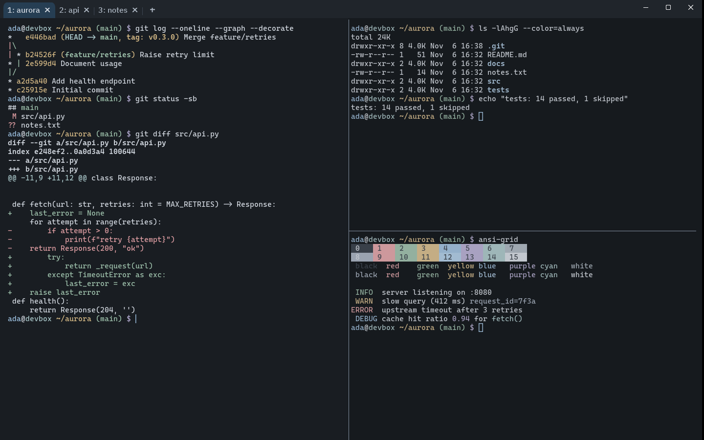
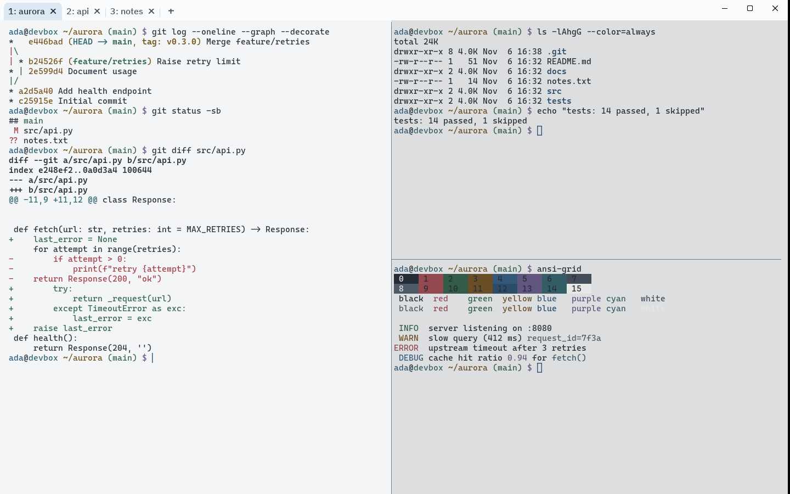

# Flatcap for WezTerm

  

<p align="center">
  
</p>

<p align="center">
  
</p>

<p align="center"><sub>Flatcap Slate (dark) above, Flatcap Daylight (light) below. Captured in WezTerm 20240203 with the software renderer.</sub></p>

**Flatcap for WezTerm** brings the Flatcap visual system to your terminal: matte graphite or soft daylight surfaces, one mineral-blue accent, and the 16 ANSI colors tied to what they mean.

It ships two color schemes, **Flatcap Slate** (dark) and **Flatcap Daylight** (light), and a plugin that applies them together with what a scheme cannot carry: the tab bar frame, the command palette and the character selector. The plugin can follow the system light/dark setting.

> The interface organizes. Content takes the foreground. Color informs.

## Install

### Option A: plugin (recommended)

```lua
local wezterm = require 'wezterm'
local config = wezterm.config_builder()

local flatcap = wezterm.plugin.require 'https://github.com/cheycron/flatcap-wezterm'
flatcap.apply_to_config(config, { mode = 'system' })

return config
```

WezTerm clones the repository the first time the config runs and does not update it afterwards; update plugins with `wezterm.plugin.update_all()` from the debug overlay (<kbd>Ctrl</kbd>+<kbd>Shift</kbd>+<kbd>L</kbd>). A complete minimal config is in [`examples/wezterm.lua`](https://github.com/cheycron/flatcap-wezterm/blob/main/examples/wezterm.lua).

**Plugin order.** `apply_to_config` registers the two schemes next to yours, selects one, copies the tab bar colors into `config.colors.tab_bar`, and merges its keys into `config.window_frame`. Call it **before** your own overrides, so they win (`config.colors`, `config.window_frame`, `config.command_palette_bg_color`...). Plugins that only register events or set unrelated options, such as [wezterm-agent-deck](https://github.com/Eric162/wezterm-agent-deck), can go before or after it. A plugin that assigns a whole new table to `config.window_frame` or `config.colors` must go **before** Flatcap, or it discards what Flatcap set.

### Option B: color scheme files

The two files in [`colors/`](https://github.com/cheycron/flatcap-wezterm/tree/main/colors) are plain WezTerm color schemes.

1. Copy `Flatcap Slate.toml` and `Flatcap Daylight.toml` into a `colors` directory:
   - Linux and macOS: `~/.config/wezterm/colors/` (the documented default).
   - Windows: the documentation names a `colors` directory next to `wezterm.exe`; to keep the files with your config, use `color_scheme_dirs` as below, for example `C:\Users\you\.config\wezterm\colors`.
2. Select the scheme:

```lua
local wezterm = require 'wezterm'
local config = wezterm.config_builder()

local dir = wezterm.home_dir .. '/.config/wezterm/colors'
config.color_scheme_dirs = { dir }
config.color_scheme = 'Flatcap Slate'

-- The native (fancy) tab bar ignores the tab colors of a scheme in WezTerm 20240203:
-- copy them from the scheme file.
local scheme = wezterm.color.load_scheme(dir .. '/Flatcap Slate.toml')
config.colors = { tab_bar = scheme.tab_bar }

return config
```

The scheme files cannot theme the window frame, the command palette or the character selector; use the plugin for those.

## Use it

### Follow the system light/dark setting

`mode = 'system'` (the default) picks Slate when WezTerm reports a dark appearance and Daylight otherwise. WezTerm re-reads the config when the appearance changes. The check is guarded because `wezterm.gui` does not exist in the mux server process; there the plugin uses Slate.

```lua
flatcap.apply_to_config(config, { mode = 'system' })
```

### One mode, always

```lua
flatcap.apply_to_config(config, { mode = 'slate' })     -- or 'daylight'
```

### Options

| Option | Default | Effect |
| :--- | :--- | :--- |
| `mode` | `'system'` | `'system'`, `'slate'` or `'daylight'`. An unknown value logs a warning and uses `'system'`. |
| `fonts` | `false` | `true` sets Cascadia Code for the terminal and IBM Plex Sans (Medium) for the tab bar. A table `{ code = '...', ui = '...' }` sets your own exact family names. |

The plugin **never** sets opacity, backdrop, blur, key bindings, font sizes or the front end. For manual control it exposes `flatcap.schemes`, `flatcap.window_frame`, `flatcap.ui` (the command palette and character selector colors) and `flatcap.names`, each keyed by `slate` and `daylight`:

```lua
config.color_schemes = { ['My Flatcap'] = flatcap.schemes.slate }
config.color_scheme = 'My Flatcap'
```

### No glass

Flatcap is matte. The theme does not set `window_background_opacity` or a backdrop (Acrylic, Mica, blur), and **Flatcap recommends opaque windows**: the contrast figures below were measured on the solid background, and translucency blends the desktop into it. If you already use `window_background_opacity = 0.85` and a backdrop, the colors will still apply, but the numbers no longer describe what you see; remove both for the Flatcap look.

### Coming from Flatcap 1

Version 2.0 replaces the Nord-derived v1 palette. If your config has hard-coded hex colors in `config.colors`, delete them and use the plugin or a scheme file; the v1 values do not map one-to-one to the new roles.

## Fonts

Flatcap starts from **Cascadia Code** for code and terminals and **IBM Plex Sans** for interface text. Neither is bundled or installed by the theme.

<!-- build:fonts -->
| Use | Family (exact) |
| :--- | :--- |
| Terminal (default) | `Cascadia Code` |
| Prompts with icons (oh-my-posh, starship) | `Cascadia Code NF` |
| No ligatures (logs, literal output) | `Cascadia Mono` |
| Tab bar, command palette (UI) | `IBM Plex Sans` |

Starting size: 15 px from `font.size.code`. `font_size` is in points: 11.25 on Windows and X11 at 96 DPI, 15 on macOS (72 DPI).
<!-- /build:fonts -->

Use the exact installed family name. Cascadia Code NF (from the Cascadia releases) and the Nerd Fonts build `CaskaydiaCove Nerd Font Mono` are different families. NF variants are only needed for prompts with icons; pass them with `fonts = { code = 'Cascadia Code NF' }`. Fonts carry their own licenses (Cascadia Code and IBM Plex Sans: SIL OFL 1.1). WezTerm logs a warning and falls back when a family is not installed. See the [Flatcap typography guide](https://github.com/cheycron/flatcap-theme/blob/main/docs/typography.md).

## Accessibility

<!-- build:a11y -->
Measured on the generated values: default text on the background is 12.2:1 in Slate and 12.1:1 in Daylight (target 7:1). Every ANSI color used as text is at least 5.7:1 on the background (lowest: 7.91:1 Slate, 5.66:1 Daylight; target 5:1). Selected text uses the `selection.fg` / `selection.bg` pair (5.6:1 Slate, 9.5:1 Daylight).
<!-- /build:a11y -->

`python3 scripts/build.py --check` fails if a generated file is stale or any of these targets is missed.

Limits that affect you:

- **Selected text is one color.** The `selection.fg` / `selection.bg` pair is applied, so text inside a selection loses its syntax colors in exchange for guaranteed contrast.
- **Bold brightens ANSI colors by default.** WezTerm shifts bold ANSI 0 to 7 to 8 to 15. In Daylight, bold ANSI white becomes the white surface color and is nearly invisible (confirmed in a screenshot). If a tool of yours hits this, set `config.bold_brightens_ansi_colors = 'No'`. Flatcap does not change that option for you.
- **ANSI backgrounds (`ESC[4Xm`).** Slate's colors are light, so dark text reads best on them; Daylight's are dark, so light text does. Ratios are in the [full mapping](https://github.com/cheycron/flatcap-wezterm/blob/main/docs/mapping.md#ansi-pairs-not-covered-by-the-table-above).
- **The current tab is told apart by fill only** in the native tab bar, because WezTerm offers no second indicator there.
- **Opacity and backdrops change the colors you see.** Keep the window opaque.
- **Inactive panes.** WezTerm's default `inactive_pane_hsb` dims them; default text stays above 8:1 in that state (an estimate). It turns Daylight's inactive panes a gray the palette does not define. Adjust `config.inactive_pane_hsb` after the plugin call if you prefer.
- **16 colors only.** Tools that emit their own true-color values (`bat`, `delta`, starship, oh-my-posh) ignore the scheme.

The per-pair ratios, the ANSI decisions and the full list of what was and was not validated are in the [full mapping](https://github.com/cheycron/flatcap-wezterm/blob/main/docs/mapping.md).

## Compatibility

- **WezTerm 20240203 or newer.** That is the version this was tested on (Linux, software renderer). The documentation dates the options the plugin uses between 20220807 and 20230712, so slightly older builds may work; none were run.
- **Verified:** both schemes loaded by WezTerm itself, the plugin in all modes, screenshots of the tab bar, splits, command palette, Quick Select, search and selection on Linux under Xvfb.
- **Not verified:** Windows and macOS, hardware front ends (`WebGpu`, `OpenGL`), light/dark switching on a real desktop, WezTerm nightly, and TUIs such as vim, htop or lazygit. Treat those as untested.
- Nightly-only color keys (`compose_fg`, `launcher_label_*`, ...) are not used.

## Contributing

The color schemes, the plugin and the generated blocks are produced from `src/theme.json`; do not edit them by hand. Run `python3 scripts/build.py --check` before opening a pull request. Mapping details are in [docs/mapping.md](https://github.com/cheycron/flatcap-wezterm/blob/main/docs/mapping.md).

## License

MIT © Cheycron Blaine. See [LICENSE](https://github.com/cheycron/flatcap-wezterm/blob/main/LICENSE).

## Support

If Flatcap makes your workspace calmer, you can support its development.

<p align="center">
  <a href="https://www.buymeacoffee.com/cheycron">
    
  </a>
</p>
